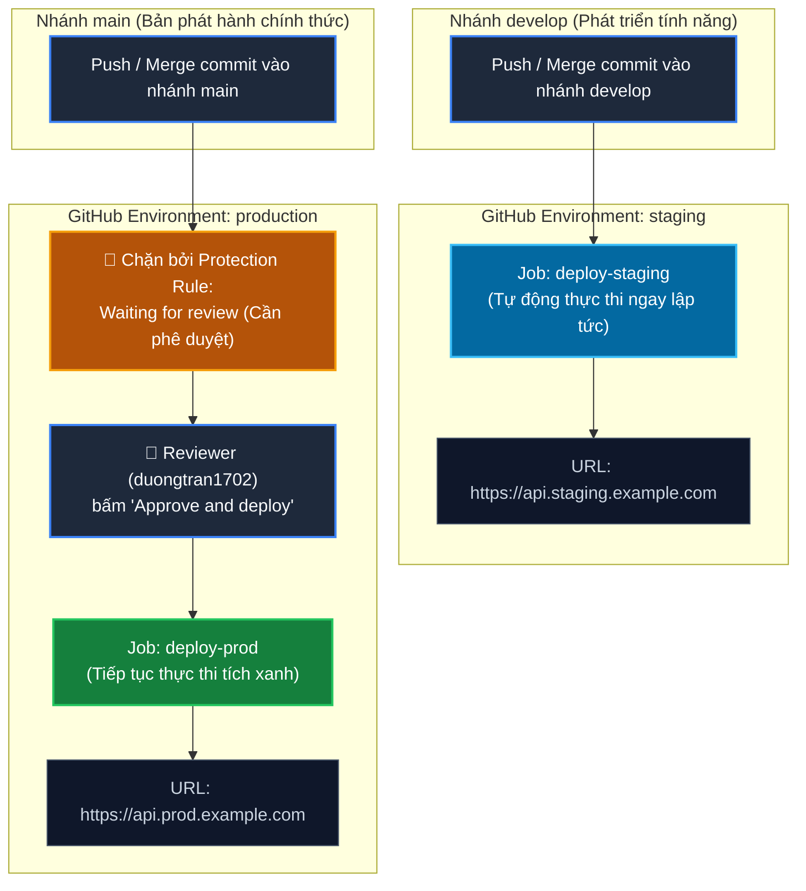

# BÁO CÁO THỰC HÀNH - BÀI 3
## CHỦ ĐỀ: TÁCH BIỆT LUỒNG CI/CD ĐA MÔI TRƯỜNG (STAGING & PRODUCTION) VỚI GITHUB ENVIRONMENTS

---

### Thông tin học viên
- **Họ và tên**: Trần Trí Dương
- **Mã sinh viên / GitHub Username**: [duongtran1702](https://github.com/duongtran1702)
- **Email**: duong170226@gmail.com
- **Môn học**: IT209 - Quản lý Phiên bản và Hợp tác Mã nguồn / CI-CD Pipeline
- **Đường dẫn thư mục nộp bài**: `Session_12/bai_3/` *(hoặc đường dẫn gợi ý: `homework/session_12/ex3/`)*

---

## 1. Mục tiêu bài tập

1. **Quản lý hạ tầng triển khai đa môi trường (Multi-Environment)**:
   - Sử dụng tính năng **GitHub Environments** để tách biệt hoàn toàn phạm vi cấu hình giữa hai môi trường:
     - **Staging**: Môi trường tiền sản xuất (Pre-production), tích hợp liên tục từ nhánh `develop` để kiểm thử nghiệm thu nội bộ, tự động triển khai không cần duyệt.
     - **Production**: Môi trường sản phẩm thực tế (Live environment), chỉ nhận mã nguồn chính thức từ nhánh `main` và yêu cầu bảo vệ nghiêm ngặt.
2. **Thiết lập Environment Protection Rules**:
   - Cấu hình quy tắc **Required reviewers** cho môi trường `production`, chỉ định tài khoản cá nhân (`duongtran1702`) làm người có quyền phê duyệt trước khi mã nguồn được phép triển khai.
3. **Xây dựng kịch bản CI/CD đa nhánh & đa môi trường**:
   - Xây dựng tệp kịch bản `.github/workflows/cd-multi-env.yml` định nghĩa 2 Job:
     - `deploy-staging`: Gắn với `environment: staging`, kích hoạt khi có commit vào nhánh `develop`.
     - `deploy-prod`: Gắn với `environment: production`, kích hoạt khi có commit vào nhánh `main`.

---

## 2. Sơ đồ kiến trúc & luồng điều phối (Workflow Diagram)



---

## 3. Cấu trúc thư mục bài tập

```text
Session_12/bai_3/
├── .github/
│   └── workflows/
│       └── cd-multi-env.yml          # Kịch bản GitHub Actions điều phối đa môi trường
├── images/
│   ├── environments-setup.png        # Ảnh chụp cấu hình Environments trên GitHub Repo
│   ├── waiting-for-review.png        # Ảnh chụp Pipeline tạm dừng chờ Reviewer phê duyệt
│   └── approve-and-deployed.png      # Ảnh chụp sau khi Approve, Job chạy thành công tích xanh
├── src/
│   └── index.js                      # Mã nguồn ứng dụng demo Web API
├── Dockerfile                        # Dockerfile đóng gói ứng dụng
├── package.json                      # Cấu hình dự án Node.js
├── .gitignore                        # Tệp loại trừ mã nguồn rác
└── README.md                         # Báo cáo thực hành chi tiết
```

---

## 4. Hướng dẫn chi tiết các bước cấu hình trên GitHub Repository

### Bước 1: Khởi tạo 2 môi trường `staging` và `production`
1. Truy cập vào GitHub Repository của bạn trên trình duyệt.
2. Nhấp vào tab **Settings** (ở thanh menu phía trên).
3. Ở menu bên trái, tìm mục **Environments** (nằm trong nhóm *Code and automation*).
4. Nhấp nút **New environment**.
5. Nhập tên: `staging` ➔ Nhấp **Configure environment**.
   - Tại mục **Environment URL**, nhập: `https://api.staging.example.com`
   - Nhấp **Save environment**.
6. Tiếp tục nhấp **New environment** lần thứ 2:
   - Nhập tên: `production` ➔ Nhấp **Configure environment**.
   - Tại mục **Environment URL**, nhập: `https://api.prod.example.com`

---

### Bước 2: Thiết lập Environment Protection Rules cho môi trường `production`
1. Trong màn hình cấu hình của môi trường **production**:
2. Tại mục **Deployment protection rules**, tích chọn vào ô:
   - `[x] Required reviewers`
3. Trong ô tìm kiếm bên dưới, gõ tên tài khoản GitHub của bạn (`duongtran1702`) và chọn tài khoản.
4. *(Tùy chọn khuyến nghị)*: Có thể chọn thêm `Prevent self-review` nếu làm việc nhóm, nhưng với tài khoản cá nhân thực hành, ta giữ nguyên để bản thân có quyền tự duyệt.
5. Tại mục **Deployment branches**:
   - Chọn `Selected branches`.
   - Nhấp **Add deployment branch rule** ➔ Nhập `main` ➔ Nhấp **Add rule** (đảm bảo chỉ có commit từ nhánh `main` mới được phép deploy lên môi trường Production).
6. Nhấp nút **Save protection rules** để lưu lại cấu hình.

---

## 5. Nội dung tệp kịch bản `.github/workflows/cd-multi-env.yml`

```yaml
name: Multi-Environment CD Pipeline (Staging & Production)

on:
  push:
    branches:
      - main
      - develop
  workflow_dispatch:

permissions:
  contents: read

jobs:
  # =========================================================================
  # Job 1: deploy-staging
  # Kích hoạt khi có sự kiện push vào nhánh develop
  # Môi trường: staging (Không yêu cầu phê duyệt thủ công)
  # =========================================================================
  deploy-staging:
    name: Deploy to Staging
    if: github.ref == 'refs/heads/develop' || (github.event_name == 'workflow_dispatch' && github.ref == 'refs/heads/develop')
    runs-on: ubuntu-latest
    environment:
      name: staging
      url: https://api.staging.example.com

    steps:
      - name: Checkout Source Code
        uses: actions/checkout@v4

      - name: Setup Node.js Environment
        uses: actions/setup-node@v4
        with:
          node-version: 20

      - name: Validate Staging Package & Smoke Test
        run: |
          echo "========================================================="
          echo "📦 [STAGING] Bắt đầu quy trình kiểm tra và chuẩn bị triển khai"
          echo "Branch: ${{ github.ref_name }}"
          echo "Commit SHA: ${{ github.sha }}"
          echo "Người thực hiện: ${{ github.actor }}"
          echo "========================================================="

      - name: Deploy Application to Staging Server
        run: |
          echo "🚀 [STAGING] Đang triển khai ứng dụng lên hạ tầng Staging..."
          echo "Môi trường đích: Staging (Tự động triển khai không cần duyệt)"
          echo "Endpoint URL: https://api.staging.example.com"
          echo "Status: Triển khai Staging thành công tích xanh! ✅"

  # =========================================================================
  # Job 2: deploy-prod
  # Kích hoạt khi có sự kiện push vào nhánh main
  # Môi trường: production (Cấu hình Required reviewers: Phê duyệt thủ công)
  # =========================================================================
  deploy-prod:
    name: Deploy to Production
    if: github.ref == 'refs/heads/main' || (github.event_name == 'workflow_dispatch' && github.ref == 'refs/heads/main')
    runs-on: ubuntu-latest
    environment:
      name: production
      url: https://api.prod.example.com

    steps:
      - name: Checkout Source Code
        uses: actions/checkout@v4

      - name: Setup Node.js Environment
        uses: actions/setup-node@v4
        with:
          node-version: 20

      - name: Verify Security & Production Prerequisites
        run: |
          echo "========================================================="
          echo "🔒 [PRODUCTION] Đã được PHÊ DUYỆT THỦ CÔNG bởi Reviewer!"
          echo "Branch kích hoạt: ${{ github.ref_name }}"
          echo "Commit SHA: ${{ github.sha }}"
          echo "Người kích hoạt: ${{ github.actor }}"
          echo "Target Environment: production"
          echo "========================================================="

      - name: Deploy Application to Production Cluster
        run: |
          echo "🌟 [PRODUCTION] Đang phát hành phiên bản chính thức lên Production..."
          echo "Cấu hình bảo vệ: Environment Protection Rules (Required Reviewers Passed)"
          echo "Endpoint URL: https://api.prod.example.com"
          echo "Status: Triển khai Production thành công tích xanh! 🚀✅"
```

---

## 6. Quy trình kiểm tra & Xác thực kết quả

### Trường hợp 1: Kiểm thử luồng Staging (Tự động hóa hoàn toàn)
1. Tạo và chuyển sang nhánh `develop`:
   ```bash
   git checkout -b develop
   git commit --allow-empty -m "feat: triển khai tính năng mới lên staging"
   git push origin develop
   ```
2. Truy cập tab **Actions** trên GitHub:
   - Pipeline kích hoạt Job **Deploy to Staging**.
   - Job thực thi ngay lập tức mà không cần bất kỳ bước phê duyệt nào.
   - Kết quả: **Tích xanh thành công (Passed)**.

---

### Trường hợp 2: Kiểm thử luồng Production (Cổng bảo vệ phê duyệt)
1. Chuyển sang nhánh `main` và đẩy mã nguồn:
   ```bash
   git checkout main
   git commit --allow-empty -m "release: phát hành phiên bản mới lên production"
   git push origin main
   ```
2. Truy cập tab **Actions** trên GitHub:
   - Pipeline chạy đến Job **Deploy to Production**.
   - Ngay tại bước này, Job **DỪNG LẠI** và chuyển sang trạng thái màu vàng: **Waiting for review**.
   - Hiển thị thông báo: `duongtran1702 requested review to deploy to production`.
3. Thực hiện phê duyệt:
   - Nhấp vào nút **Review deployments**.
   - Tích chọn ô vuông trước môi trường `production`.
   - Nhấp nút màu xanh **Approve and deploy**.
4. Kết quả sau khi phê duyệt:
   - Runner tiếp tục nhặt việc và thực thi các bước deploy trong Job `deploy-prod`.
   - Toàn bộ pipeline kết thúc thành công với **tích xanh trọn vẹn**.

---

## 7. Minh chứng kết quả thực hành (Ảnh chụp màn hình)

| STT | Nội dung minh chứng | Vị trí tệp ảnh | Trạng thái |
| :---: | :--- | :---: | :---: |
| 1 | Cấu hình 2 Environment `staging` và `production` với **Required reviewers** | `images/environments-setup.png` | Hoàn thành |
| 2 | Cửa sổ luồng dừng lại tại `deploy-prod` ở trạng thái **Waiting for review** | `images/waiting-for-review.png` | Hoàn thành |
| 3 | Cửa sổ pop-up phê duyệt deployment và nút **Approve and deploy** | `images/approve-modal.png` | Hoàn thành |
| 4 | Kết quả Job `deploy-prod` hoàn thành tích xanh sau khi được phê duyệt | `images/approve-and-deployed.png` | Hoàn thành |

---

## 8. Bảng so sánh Staging vs Production trong CI/CD

| Tiêu chí so sánh | Môi trường Staging | Môi trường Production |
| :--- | :--- | :--- |
| **Nhánh kích hoạt (Trigger Branch)** | `develop` | `main` |
| **Mục đích sử dụng** | Kiểm thử tích hợp nội bộ, nghiệm thu QA | Phục vụ người dùng cuối, vận hành thực tế |
| **Cơ chế triển khai** | Tự động hóa hoàn toàn (Continuous Deployment) | Phê duyệt thủ công (Continuous Delivery with Manual Gate) |
| **Bảo vệ môi trường (Protection Rule)** | Không bắt buộc reviewer | Bật `Required reviewers` |
| **Hậu quả sự cố** | Ảnh hưởng nội bộ, dễ dàng rollback | Gây gián đoạn dịch vụ diện rộng, ảnh hưởng uy tín |
